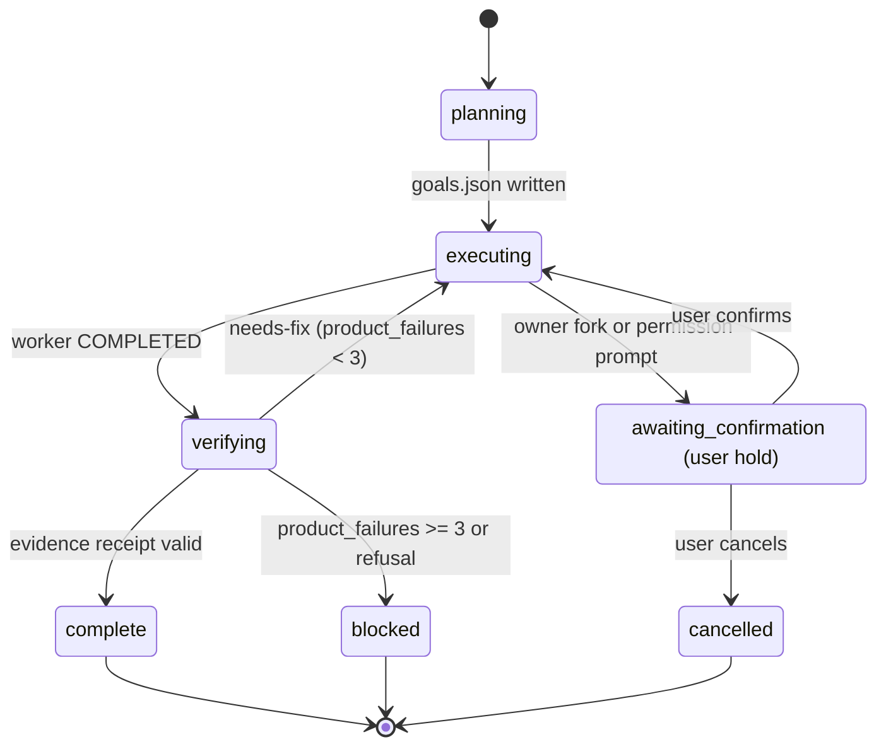

# Blast-Radius Impact & Statechart Extraction (`$analyze --blast-radius` & `--statechart`)

Reference playbook for [`skills/analyze/SKILL.md`](../SKILL.md). Load this reference when `$analyze` is invoked with `--blast-radius <symbolOrFile>` (pre-change dependency & regression-gap mapping) or `--statechart <moduleOrFlow>` (explicit/implicit state-machine extraction and transition-gap auditing). Both modes are strictly **read-only** and never modify repository files.

## 1. Change Impact & Regression Mapping (`$analyze --blast-radius <symbolOrFile>`)

Use `--blast-radius` before changing a shared function signature, refactoring a module boundary, altering a `.omagy/state/*` or database schema, or removing exports so every downstream caller and test gap is proven with `file:line` citations.

### Step 1: 1-Call `codegraph_explore` Fast Path + Dirty-File Fallback
1. **1-Call `codegraph_explore` Fast Path (when indexed)**:
   - When the `codegraph` MCP server is available and the repository is indexed, issue **one** `call_mcp_tool` call (`ServerName: "codegraph"`, `ToolName: "codegraph_explore"`) on `<symbolOrFile>` to map symbol definitions, direct callers, callees, and transitive call chains in a single round-trip.
2. **Immediate `grep` / `read_file` Fallback & Dirty-Worktree Cross-Check**:
   - Fall back immediately to `run_command` (`grep -rnE`, `find`, `git status --short`) and targeted `read_file` line ranges whenever `codegraph` is unavailable, unindexed, or `git status --short` shows modified/untracked files whose live contents differ from the index.
   - Always check dynamic dispatch edges that static call graphs can miss:
     - CLI command routing tables (for example, `hooks/run.sh` and `handleColdCliCommand` dispatchers),
     - string-keyed event listeners, IPC handlers, or RPC method registries,
     - barrel re-exports (`index.ts` / `index.mjs`) and dynamic `await import(...)` boundaries,
     - configuration/manifest references (`.json`, `.yaml`, `.toml`, CI workflows).

### Step 2: Four-Bucket Impact Classification
Classify every discovered dependent into four concrete buckets, tagging each row with `file:line` provenance and confidence (`certain | likely | unlikely | unverified`):

1. **Direct Callers**:
   - Functions, methods, hooks, or components importing or calling `<symbolOrFile>` directly, noting exact positional arguments, option keys, return-type destructuring, and thrown-error assumptions.
2. **Transitive Entrypoints / Routes / CLI**:
   - Top-level user or runtime surfaces reached upstream from direct callers (HTTP/GraphQL endpoints, CLI flags/subcommands, lifecycle hooks `SessionStart`/`PreInvocation`/`PreToolUse`/`Stop`, scheduled jobs, or UI screens).
3. **Shared State / Schema Coupling**:
   - Persisted state files (`.omagy/state/*-state.json`, `.omagy/ultragoal/goals.json`, `.omagy/evidence/*.json`), database tables, cache keys, environment variables, or wire payloads coupled to the target.
4. **Missing Regression Coverage**:
   - Locate existing unit/integration/selftest assertions covering each direct caller and entrypoint, then isolate **untested caller branches or failure paths** that could break silently.

### `--blast-radius` Output Contract
Include these two structured blocks inside the `$analyze` synthesis:

```markdown
### Blast-Radius Map: `<symbolOrFile>`
| Bucket | Dependent Surface (`file:line`) | Contract / Coupling Assumption | Confidence | Existing Test Coverage |
| :--- | :--- | :--- | :---: | :--- |
| Direct Caller | `src/auth/session.ts:48` | Destructures `{ userId, expiresAt }` | `certain` | `tests/session.test.ts:22` |
| Transitive Entrypoint | `src/routes/login.ts:19` | Maps `null` return to HTTP 401 | `certain` | **Missing** (happy-path only) |
| Shared State / Schema | `.omagy/state/team-state.json` | Reads `state.team` string | `certain` | `hooks/omagy-selftest.mjs:1080` |

### Pre-Edit Lock Checklist (Read-Only Recommendation)
1. **Highest-risk caller**: `<file:line>` — <why it breaks first if signature/behavior shifts>.
2. **Regression lock needed first**: `<test file or command>` covering `<missing branch>`.
3. **Safe change order**: <1-line contract-first sequence>.
```

## 2. State-Machine Extraction & Transition Audit (`$analyze --statechart <moduleOrFlow>`)

Use `--statechart` to reverse-engineer explicit or implicit finite-state machines (workflow lifecycles, `.omagy/state/*-state.json` transitions, async UI `idle/loading/ready/error` stores, retry/backoff/circuit-breaker loops, worker task lifecycles) into a verified diagram plus a transition-defect table.

### Step 1: Harvest State Variables, Guards & Side Effects
1. Locate all state-bearing fields (`status`, `phase`, `current_phase`, `active`, enum constants, reducer `switch` branches, and orthogonal boolean flags such as `isPending` + `isError`) using the 1-call `codegraph_explore` fast path or `grep -rnE` + `read_file`.
2. Extract every transition tuple `(FromState, Event/Trigger, Guard, Persistence/SideEffect, ToState)` with exact `file:line` citations.
3. Surface **implicit product states** formed by loosely coupled fields (for example, `active: true` combined with `current_phase: "complete"`, or `status: "in_progress"` with `worker: null`).

### Step 2: Render Valid GitHub-Flavored Mermaid `stateDiagram-v2`
Emit a clean `stateDiagram-v2` block obeying strict Mermaid syntax rules:
- Declare `state "Quoted Label (Detail)" as safe_id` aliases whenever labels contain spaces, parentheses, brackets, slashes, or colons.
- Never embed raw HTML tags (`<br>`, `<b>`) inside Mermaid labels.
- Include explicit `[*] --> <InitialState>` entry transitions and `<TerminalState> --> [*]` exits for every true terminal state.

````markdown

````

### Step 3: Dead / Unreachable / Missing-Transition Audit Table
Audit every extracted statechart against five structural hazard classes and report concrete `file:line` evidence:

| Hazard Class | What to Check in Code |
| :--- | :--- |
| **1. Dead / Unreachable State** | Enum/phase literal declared in schema or types with zero live inbound transitions |
| **2. Stuck Non-Terminal State** | Active state (`executing`, `loading`, `verifying`) missing an error, timeout, or `$cancel` exit transition |
| **3. Double-Submit / Race Window** | Async transition lacking an in-flight guard, lock, capacity reservation, or idempotency key on rapid re-entry |
| **4. Contradictory Compound State** | Impossible field combinations left writable (`active: true` + `completed_at`, or `in_progress` + `worker: null`) |
| **5. Torn Persistence Boundary** | External side effect executed before state/ledger write without crash-recovery or rollback reconciliation |

```markdown
### Dead / Unreachable / Missing-Transition Audit Table
| Anomaly Class | State / Transition | Evidence (`file:line`) | Concrete Failure Scenario | Confidence |
| :--- | :--- | :--- | :--- | :---: |
| Stuck Non-Terminal | `verifying -> cancelled` | `src/runner.ts:142-168` | Aborting while `verifier` times out leaves `active: true` | High (Tier 2) |
| Double-Submit Race | `idle -> submitting` | `src/ui/form.tsx:88` | Double-click before `setSubmitting(true)` fires two POSTs | High (Tier 2) |
| Unreachable State | `paused` | `src/types.ts:14` | Defined in union type; zero writers across repository | High (Tier 2) |
```

## 3. Delegation & Evidence Discipline Across Both Modes

1. **Parallel `tracer` fan-out for multi-subsystem graphs**:
   - When `--blast-radius` spans `>= 3` subsystems (for example, CLI + hook runtime + UI sidecar) or `--statechart` spans coupled parent/child state machines (for example, `autopilot-state.json` + `ultragoal-state.json` + `team-state.json`), dispatch up to 3 read-only `tracer` or `explore` subagents in parallel and merge their `file:line` tables in the leader lane.
2. **Strict Evidence vs Inference Separation**:
   - Tag direct `codegraph_explore` edges, `grep` hits, and reducer branches as **Evidence** (`Tier 2`).
   - Tag runtime timing/race conclusions without an executed reproduction as **Inference** (`Tier 3`–`Tier 4`) and name the single fastest read-only probe to confirm them.
   - Tag dynamic external callers outside the opened workspace as **Unknown** (`unverified`).
3. **Read-Only Stop Boundary**:
   - Never edit production files, test files, or `.omagy/state/*` during `--blast-radius` or `--statechart`. End with the ranked synthesis, structured table/diagram, and smallest recommended next probe or lock test.
