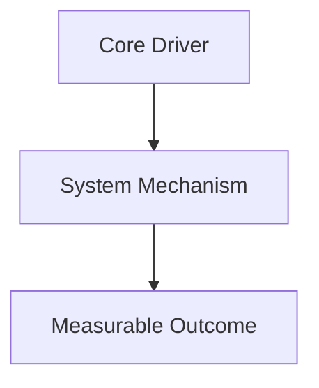
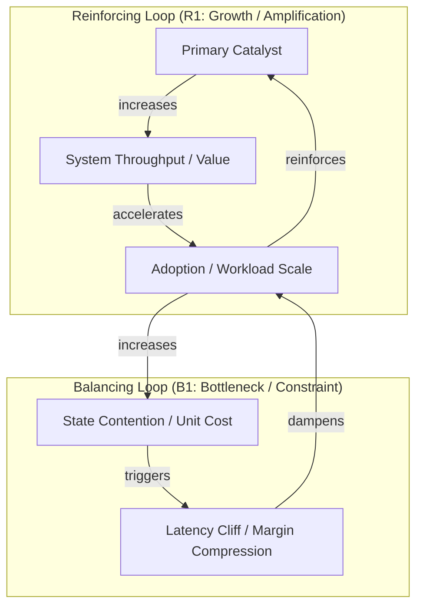
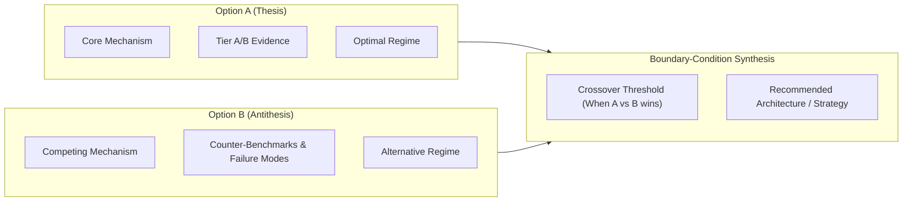

# Deep Research Report Template & Mermaid Visualization Patterns

Reference template for [`skills/deep-research/SKILL.md`](../SKILL.md). Save completed reports to `.omagy/artifacts/research/deep-research-<slug>-<UTC>.md` and validate with `sh <PLUGIN_DIR>/hooks/run.sh audit-research <reportPath>`.

---

## 1. Report Markdown Template

```markdown
# [RESEARCH TITLE]: A Multi-Lens Deep Investigation

- **Slug**: `<slug>`
- **Lens(es)**: `technical | business | idea | implementation`
- **As Of**: `<YYYY-MM-DD / version anchor>`
- **Status**: `Audited (>= 85/100)`

---

## 1. Executive Summary

- **Core Thesis & Recommendation**: One concise paragraph stating the primary question, structural context, and recommended decision.
- **Key Empirical & Structural Findings**:
  - Finding 1 (`[VERIFIED]` / `[DERIVED]` / `[ASSUMED]` + source/file citation)
  - Finding 2 (`[VERIFIED]` / `[DERIVED]` / `[ASSUMED]` + source/file citation)
  - Finding 3 (`[VERIFIED]` / `[DERIVED]` / `[ASSUMED]` + source/file citation)
- **Primary Tradeoffs & Contradictions**: The central tension decision-makers must navigate.
- **Immediate Action & Handoff**: Recommended next step (`/ralplan`, `/ultragoal`, `/deep-interview`, or kill/pivot).

---

## 2. Introduction, Context & Scope

### 2.1 Problem Statement & Boundary Conditions
- Operational definition of the subject, what is in-scope, and what is explicitly out-of-scope.
- Brownfield repository context (when applicable: relevant modules, existing stack, constraints).

### 2.2 Evolution & Why Now
- Key technical, market, or architectural inflections that make this investigation critical now.

---

## 3. Research Methodology & Evidentiary Framework

### 3.1 Active Lenses & Subagent Routing
- Lenses applied (`--technical`, `--business`, `--idea`, `--implementation`) and specialist lanes consulted (`explore`, `researcher`, `architect`, `planner`).

### 3.2 Search Strategy & Source Tier Distribution
- Summary of Boolean query clusters executed (`research-matrix`).
- Source breakdown across **Tier A** (specs/benchmarks/code), **Tier B** (official docs/papers/filings), **Tier C** (analyst/case studies), and **Tier D/E** (leads only).

---

## 4. Multidimensional Analysis

### 4.1 Core Lens Deep-Dive (`Technical` / `Business` / `Idea` / `Implementation`)
- First-principles mechanics, quantitative benchmarks/unit economics, and structural drivers.
- Comparative option matrix (Option A vs. Option B vs. Status Quo) with `[VERIFIED]`, `[DERIVED]`, and `[ASSUMED]` tags.

### 4.2 Cross-Lens Interactions
- How technical architecture choices impact unit economics, product UX, or implementation complexity.

### 4.3 Contradictions, Anomalies & Boundary Conditions
- Side-by-side arbitration of conflicting benchmarks, competing theories, or vendor claims, specifying the exact parameter thresholds where each option wins.

---

## 5. Interpretation, Synthesis & Systemic Modeling

### 5.1 Unified Systemic Model
- Reinforcing feedback loops, balancing bottlenecks, and emergent scaling/adoption thresholds.

### 5.2 Systemic Visualization



---

## 6. Uncertainty, Risks, Gaps & Falsification Criteria

### 6.1 Epistemic Gaps & Unverified Assumptions
- Explicit list of `[ASSUMED]` claims and missing data that could shift the conclusion.

### 6.2 Failure Modes & Falsification Tests
- Concrete conditions, spike experiments, or kill metrics that would falsify the primary thesis.

---

## 7. Conclusions & Strategic Recommendations

### 7.1 Definitive Conclusions
- Summary of proven facts (`[VERIFIED]`) vs. derived projections (`[DERIVED]`) vs. open hypotheses (`[ASSUMED]`).

### 7.2 Builder & Stakeholder Action Matrix

| Priority | Target / Owner | Action / Decision | Verification / Success Metric |
| :--- | :--- | :--- | :--- |
| **P0** | Engineering / Builder | Concrete architectural or implementation step | Test / benchmark / metric |
| **P1** | Product / Strategy | Validation experiment, scope gate, or pricing rule | User / business signal |
| **P2** | Risk / Operations | Safeguard, fallback, or observability check | Alert / threshold |

### 7.3 Workflow Handoff
- **Recommended Next Skill**: `/ralplan` | `/ultragoal` | `/deep-interview`
- **Carry-Forward Invariants**: Bullet list of constraints to lock into the plan/spec.

---

## 8. Glossary of Core Concepts

| Term / Concept | Category | Canonical Definition | Competing / Divergent Usage |
| :--- | :--- | :--- | :--- |
| `Term 1` | Core | Baseline definition | Alternative vendor/domain meaning |
| `Term 2` | Mechanism | Baseline definition | Alternative vendor/domain meaning |

---

## 9. Research Self-Assessment Scorecard

| Dimension | Target Score | Actual Score | Justification & Evidentiary Proof |
| :--- | :---: | :---: | :--- |
| **1. Depth of Analysis** | >= 85 | 90 | First-principles mechanics and root drivers established with Tier A/B evidence. |
| **2. Systemicity** | >= 85 | 88 | Reinforcing and balancing loops modeled with Mermaid diagram. |
| **3. Critical Thinking** | >= 85 | 91 | Competing options arbitrated with explicit parameter thresholds and claim tags. |
| **4. Interdisciplinarity** | >= 85 | 87 | Technical, product, and implementation constraints integrated. |
| **5. Practical Applicability** | >= 85 | 92 | Concrete P0-P2 action matrix and falsification criteria provided. |
| **Overall Composite** | >= 85 | 89.6 | Audited via `hooks/run.sh audit-research`. |
```

---

## 2. Reusable Mermaid Diagram Templates

### A. Reinforcing & Balancing Causal Loop Diagram


### B. Dialectical Contradiction & Parameter Synthesis

